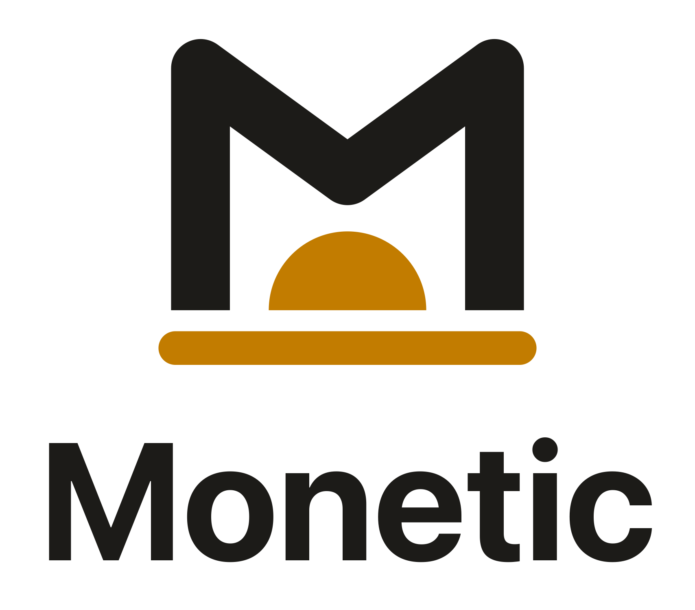

# Monetic

<p align="center">
  
</p>

Monetic helps college students afford the trips they want. It tells you what a trip will cost, turns that into a savings plan that fits your real monthly budget, and lets friends join the plan with a link.

It's still a budgeting app. Trips are the reason to open it, and the monthly budget is what keeps the savings plan realistic. Along the way it builds good money habits early: knowing what something costs before you commit, and saving for it ahead of time.

## What The App Does

Monetic has two tabs, Budget and Trips.

On the Trips tab, you can:

- plan a trip with a destination, dates, number of travelers, and travel style
- get a cost estimate from U.S. government per diem rates, broken into lodging, food, local transport, activities, and flights
- set a savings goal (your share of the trip by default) and how often you save: weekly, every two weeks, or monthly
- log money you put aside or take back out, and see whether you're on track
- count down to departure
- share the plan with friends by link, so they can add it on their own phones
- after the trip, log what you actually spent and compare it with the estimate

On the Budget tab, you can:

- set a monthly budget
- create and manage spending groups
- add one-time or recurring expenses
- review spending by group and see the month as a chart

Money you save for a trip comes out of that month's budget, so the dashboard shows what you really have left.

## Why It Was Made

College students often pick a trip, like spring break or a semester abroad, without knowing what it will really cost. They start saving too late, or not at all. Then they come up short, put it on a credit card, or end up covering for a friend who couldn't pay.

Most budgeting apps track spending after it happens. Monetic starts from the goal instead. It puts a real price on the trip, shows how much to save each week or month, and checks that amount against the monthly budget. If the plan doesn't fit, you find out months before you leave, not at the airport.

Monetic is not a spending tracker for during the trip, a bill splitter (Splitwise works fine for that), or an itinerary planner.

## How It's Different

- **The trip goal and the everyday budget are connected.** Savings count against the month you save in, and the plan warns you when each contribution would be more than your whole budget for that period.
- **Estimates come from cited public data, not guesses.** Every rate comes from the U.S. State Department or GSA, and the estimate shows its source and effective date. The optional "Describe your trip" assistant runs on device and only fills in the form: where, when, how many people, and what style. It never invents prices: the only amount it keeps is a flight price you typed yourself.
- **It works offline.** The cost data is bundled with the app, so estimating needs no network.
- **Your data stays on your phone.** There's no account and no server. A trip link carries only the plan: destination, dates, travelers, style, and the estimate. It never includes your budget, expenses, savings, or notes.

## Framework And Tech Stack

Monetic is built with Apple's modern native iOS tools:

- `SwiftUI` for the user interface and navigation
- `SwiftData` for local data persistence
- `Charts` for spending visualizations
- `AppStorage` for lightweight settings like appearance, currency, and monthly budget preferences
- `UserNotifications` for local savings reminders
- `FoundationModels` (iOS 26+, Apple Intelligence devices only) for the optional "Describe your trip" assistant

SwiftData stores four models: `BudgetCategory`, `Transaction`, `Trip`, and `SavingsContribution`. New `Trip` properties all have defaults, so older stores migrate automatically.

The project currently targets `iOS 17.0+`.

## Design System

The interface is built on a single design system rather than SwiftUI defaults. Everything visual is defined in `Monetic/DesignSystem/`:

- `Brand.swift` — colors, surfaces, type scale, radii, and spacing tokens. Every surface is declared once and resolves per interface style.
- `CategoryPalette.swift` — the nine hues a spending group can be tinted with, plus the mapping that resolves color names stored by earlier versions.
- `BrandComponents.swift` — shared cards, buttons, the budget ring, progress bars, the segmented control, the amount field, and the tab bar.

The look is a "pocket notebook": warm paper, dark ink, and one accent color used for primary buttons, links, and selection. The logo's blue-to-magenta gradient is kept for the logo and app icon only. The full spec is in `docs/prompts/ui-overhaul/DESIGN-BRIEF.md`, and `BrandContrastTests` checks contrast in both modes.

The app follows the iPhone's Light or Dark setting by default. Users can pick Light or Dark in Settings instead.

## Main Features

### Trips

- Trip cost estimates from bundled per diem data for about 1,300 U.S. and foreign locations, with Budget, Standard, and Comfort travel styles, an adjustable room count, and an optional flight price for the group
- A cost breakdown that shows each line item, the per-person share, and where the rates came from
- Trips to places not in the data, with a total you type in
- A savings plan: goal, cadence, amount per period, and on-track status, checked against the monthly budget
- Deposits and withdrawals toward a trip, with optional local reminders on each savings date
- A countdown to departure on the Trips list and the home dashboard
- Share links (`monetic://trip?d=…`) that let friends add the same plan to their phones. Each phone keeps its own copy, and nothing syncs afterward.
- "Describe your trip": type a sentence and the on-device model fills in the form (iOS 26+ with Apple Intelligence; the form works without it)
- Estimate vs. actual: after the trip, log what you spent per line item and see how far off the estimate was

### Budget

- Monthly budget summary with remaining balance and progress tracking, minus money set aside for trips that month
- Expense grouping with custom names, colors, and icons
- Recurring monthly and yearly expense support
- Group detail views for reviewing transactions
- Onboarding flow with starter groups
- Settings for appearance, currency (any common currency, with entry that follows its decimal places), and monthly budget rollover, including a one-tap option to roll last month's budget into the current month

Per diem estimates are always in U.S. dollars, since Monetic doesn't convert currencies. Trips with a total you typed use your chosen currency.

### Coming next

- Live sync for group trips, so changes reach everyone who joined. It's designed in `docs/design/group-trips-sync.md` but not built.
- Seasonal lodging prices for popular single-rate destinations. The research and review pipeline is built (`scripts/research-seasonality/`), but no destinations have been approved yet, so the app doesn't apply any.

### Budget Rollover

When "Repeat Monthly Budget" is on in Settings, Monetic no longer silently carries the old budget forward. Instead:

- At the start of a new month, the budget prompt leads with a **"Roll Over Last Month's Budget ($X)"** button so the amount carrying forward is explicit, with "Set a Different Amount" as a secondary option.
- A matching **"Roll Over Last Month's Budget"** row appears in Settings any time the current budget differs from the last one recorded, so the amount can be reapplied later even outside the new-month prompt.

With the toggle off, the app still prompts for a new budget each month, offering "Keep Last Month's Budget" as a fallback.

## Data Sources

Trip cost estimates come from two U.S. government publications, bundled in `Monetic/Resources/cost-data.json`:

- **U.S. Department of State** foreign per diem rates (DSSR 925), publication effective November 1, 2026. Each foreign location also carries its own effective date.
- **U.S. General Services Administration (GSA)** per diem rates for the continental U.S., fiscal year 2027, effective October 1, 2026.

Each estimate uses the location's maximum lodging rate and its meals and incidentals rate.

Per diem rates are a ceiling for government business travel, not what a student pays. The travel styles scale them down: Budget assumes about 45% of the lodging rate and 50% of the meals rate, Standard 75% and 80%, and Comfort 100% of both. Local transport and activities have no government rate, so they're estimated as a share of the meals rate. **These percentages are product assumptions, not data.** The app labels them that way, and they're defined in `Monetic/Estimating/TripEstimator.swift`.

To refresh the data, update the pinned URLs and dates in `scripts/fetch-cost-data.sh` and the constants at the top of `scripts/build-cost-data.py`, then run:

```sh
scripts/fetch-cost-data.sh && python3 scripts/build-cost-data.py
```

The raw downloads go to `data/raw/`, which is gitignored. Only the generated JSON is committed, and the build is deterministic: the same inputs give a byte-identical file.

## Screenshots

<table>
<tr>
<td width="25%"></td>
<td width="25%"></td>
<td width="25%"></td>
<td width="25%"></td>
</tr>
<tr>
<td align="center"><sub>Dashboard</sub></td>
<td align="center"><sub>Spending groups</sub></td>
<td align="center"><sub>Spending overview</sub></td>
<td align="center"><sub>Settings</sub></td>
</tr>
</table>


## Marketing Website

A companion landing page showcases the app ahead of launch. It's a single self-contained HTML page (no build step, no framework) currently published as a private Claude artifact, pending a real domain.

### What's on it

- **Hero** — headline, pitch, and the live dashboard screenshot in a realistic device frame with an ambient blue/violet glow behind it
- **Feature walkthrough** — four alternating sections pairing real app screenshots (not mockups) with copy: spending groups, logging an expense, the spending-overview ring chart, and appearance/rollover settings
- **How it works** — a three-step onboarding preview (set a budget → pick starter groups → log as you go), each with a compact screenshot
- **Early access** — a waitlist form that opens the visitor's email client addressed to me, since there's no backend to store submissions yet
- **Trust strip** — a quick native-tech callout (SwiftUI, SwiftData, Swift Charts, iOS 17+)

### Brand consistency

Colors weren't picked separately from the app — they were sampled directly from the real UI and the logo: the electric blue → violet → magenta gradient, the near-black surfaces, and the coral/gold chart accents. Typography is Fraunces (headlines) + Sora (body) + JetBrains Mono (numbers), which the app's design system doesn't use, since the site can lean more editorial than the in-app UI.

### Status

Pre-launch. No App Store or TestFlight link yet — the CTA collects interest via email instead. Next step is moving it off the Claude artifact link onto a real domain (static host + DNS), at which point this section should get an update with the live URL.


## Running The Project

1. Open `Monetic.xcodeproj` in Xcode.
2. Choose an iPhone simulator or connected device.
3. Build and run the app.

## Running Tests

**Rule: run the unit suite before opening a PR, and add a test with every bug fix.**

Pull requests into `main` also run the unit suite automatically on GitHub Actions (`.github/workflows/tests.yml`).

- **Xcode:** Product → Test (⌘U) runs everything.
- **Command line:** `scripts/test.sh` picks an available iPhone simulator for you:

  ```sh
  scripts/test.sh        # unit tests only, the fast pre-PR check
  scripts/test.sh ui     # UI tests only
  scripts/test.sh all    # everything, including the demo tour
  ```

  To choose the simulator yourself, set `DESTINATION`, or call xcodebuild directly:

  ```sh
  xcodebuild test -project Monetic.xcodeproj -scheme Monetic \
    -destination 'platform=iOS Simulator,name=iPhone 16,OS=18.0' \
    -only-testing:MoneticTests
  ```

  `name=` only matches a simulator on the newest iOS you have installed unless you also give `OS=`. `xcrun simctl list devices available` shows what you have.

- **After updating Xcode**, simulators stay disabled ("CoreSimulator is out of date") until first-launch setup runs. Open Xcode once, or run `sudo xcodebuild -runFirstLaunch`. `scripts/test.sh` checks for this.

What's covered:

| Suite | What it checks |
| --- | --- |
| `MoneticTests/CategoryTransactionTests` | Adding expenses works for all 9 starter groups plus a custom one: saving, reloading, totals, recurring, validation, creating groups |
| `MoneticTests/BudgetCategoryTests` | Which expenses count toward a month (one-time, monthly, yearly, month and year boundaries), budget % and over-budget |
| `MoneticTests/PersistenceTests` | Deleting groups and expenses, editing amounts and dates, reordering |
| `MoneticTests/TransactionTests`, `FormattingTests`, `MonthRolloverTests` | Date normalization, amount entry, month keys, currency, icons, the new-month budget prompt |
| `MoneticTests/TripTests`, `TripPersistenceTests`, `StoreMigrationTests` | Trip dates, nights, countdown, list order, saving and reloading, migrating older stores |
| `MoneticTests/TripEstimatorTests`, `CostDataStoreTests`, `SeasonalIndexTests` | Estimate math and rounding, travel styles, seasons, location search, the bundled data |
| `MoneticTests/SavingsPlanTests`, `SavingsContributionTests`, `SavingsReminderTests` | Savings targets and on-track status, the budget check, deposits and withdrawals, reminders |
| `MoneticTests/TripShareTests` | Trip links: what's encoded, that no money goes in, joining, rejecting broken links |
| `MoneticTests/TripAssistantTests`, `EstimateAccuracyTests` | Turning a trip description into form values, estimate vs. actual |
| `MoneticTests/AppAppearanceTests`, `BrandContrastTests` | The appearance setting, and color contrast in both modes |
| `MoneticUITests/AddExpenseUITests` | End to end: onboarding → set budget → add expense → group and home totals update |
| `MoneticUITests/TripsUITests` | End to end: adding, estimating and saving for a trip, joining from a link, a broken link, the trip assistant (with a canned model) |

`MoneticUITests/MoneticDemoUITests` is a screen-recording tour and `ScreenTourUITests` captures screenshots (`scripts/screenshots.sh`). Neither is a correctness test. `TripIntentEvalTests` scores the assistant against the on-device model and only runs through `scripts/eval-trip-intent/run.sh`.

Writing a test:

- Use Swift Testing (`@Test`, `#expect`) for unit tests and put shared helpers in `MoneticTests/TestSupport.swift`. Use XCTest only for UI tests.
- Use a fresh in-memory store (`TestSupport.makeContainer()`) and fixed dates (`TestSupport.date(2026, 3, 14)`). Never depend on today's date or the device locale.
- Add every new test file to its target in Xcode. The project doesn't use synchronized folders.
- If a test finds a bug you aren't fixing yet, wrap the expectation in `withKnownIssue("…")` so the suite stays green and the bug stays visible.
- UI tests launch the app with `-UITesting YES` (Debug builds only). The app then starts with an empty in-memory store and first-launch settings.

## Status

This is a native iOS app under active development and stores all data locally on device using SwiftData. There is no account or server.

## Built With Claude Code

This project was developed using [Claude Code](https://claude.ai/code) with the following plugins and skills:

### Plugins
- **[ECC](https://github.com/affaan-m/ECC)** — core skill library providing SwiftUI patterns, feature development workflows, and code review tools
- **[claude-mem](https://github.com/anthropics/claude-code)** — persistent memory across sessions to maintain project context and coding preferences
- **[superpowers](https://github.com/anthropics/claude-code)** — meta-skills for planning, brainstorming, and execution workflows

### Skills Used
- `ecc:swiftui-patterns` — guidance on SwiftUI layout, state management, and navigation patterns
- `superpowers:brainstorming` — planning app structure and feature design
- `superpowers:executing-plans` — step-by-step implementation of development plans

### Commands Used
- `/ecc:feature-dev` — structured workflow for implementing new features
- `/ecc:code-review` — code quality review during development
