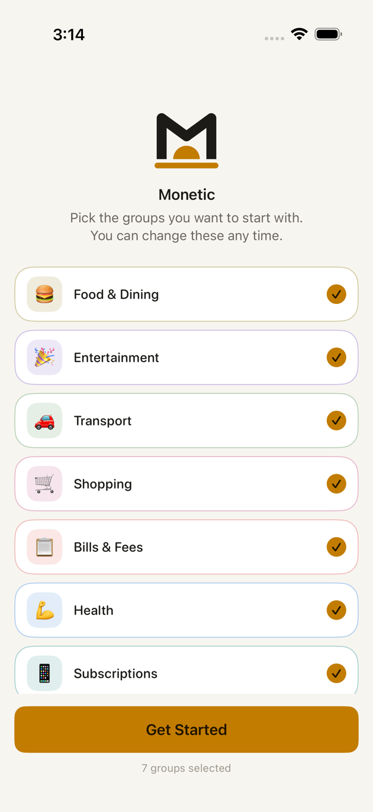
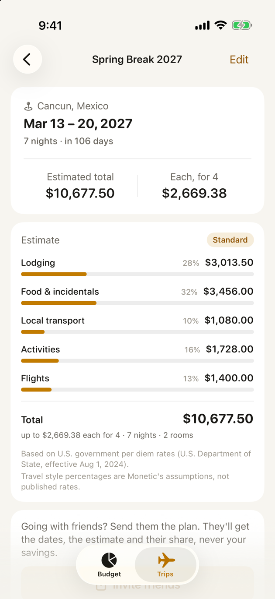
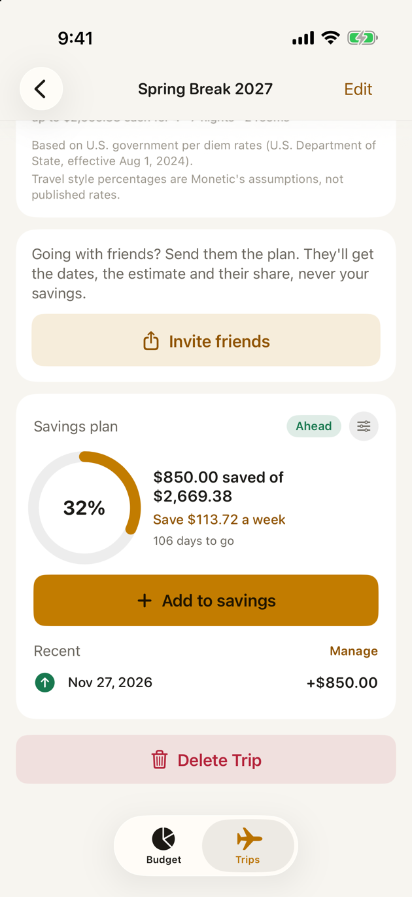
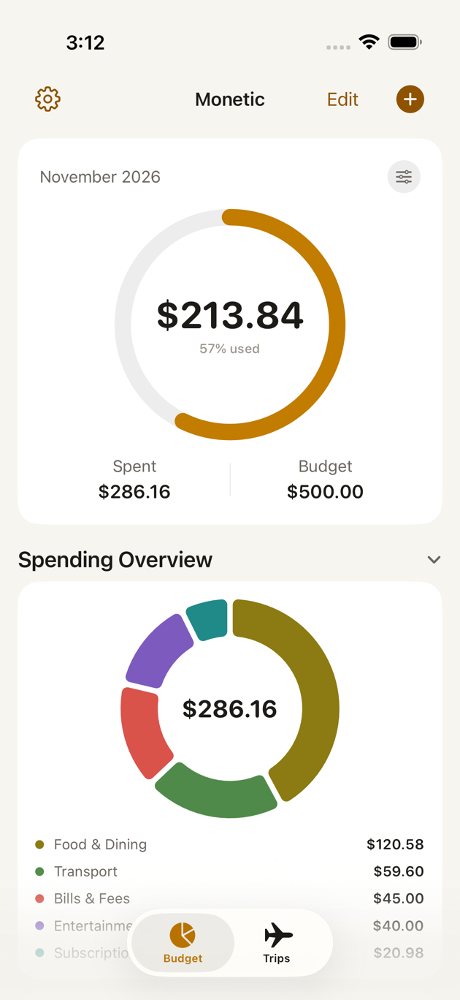

<p align="center">
  <picture>
    <source media="(prefers-color-scheme: dark)" srcset="Marketing/Brand/monetic-logo-dark.png">
    
  </picture>
</p>

<h3 align="center">Afford the trips you actually want.</h3>

<p align="center">
  Monetic tells college students what a trip will really cost, turns it into a savings plan that fits their monthly budget, and brings their friends into the plan with one link.
</p>

<p align="center">
  <a href="https://github.com/tonyp0/Monetic/actions/workflows/tests.yml"></a>
  
  
  
  
</p>

<p align="center">
  <a href="#features">Features</a> ·
  <a href="#getting-started">Getting started</a> ·
  <a href="#how-estimates-work">How estimates work</a> ·
  <a href="#roadmap">Roadmap</a> ·
  <a href="CONTRIBUTING.md">Contributing</a>
</p>

<p align="center">
  
  
  
  
</p>

---

## Why Monetic

College students pick a trip, like spring break or a semester abroad, without knowing what it will really cost. They start saving too late, or not at all, and end up short, on a credit card, or covering for a friend.

Most budgeting apps track spending after it happens. **Monetic starts from the goal.** It puts a real, cited price on the trip, shows how much to save each week or month, and checks that amount against the monthly budget. If the plan doesn't fit, you find out months before you leave, not at the airport.

Monetic is not an in-trip spending tracker, a bill splitter (Splitwise works fine for that) or an itinerary planner.

## Features

### ✈️ Trips

- **Real cost estimates.** Pick a destination, dates, travelers and a travel style (Budget, Standard or Comfort). Monetic builds an estimate from U.S. government per diem rates for about 1,300 U.S. and foreign locations, broken into lodging, food, local transport, activities and flights, with the source on screen.
- **A savings plan that fits.** Set a goal (your share by default) and a cadence (weekly, every two weeks or monthly). Monetic shows what to save each period, whether you're on track, and warns you when the plan is more than your budget allows.
- **Countdown to departure** on the Trips tab and the Budget dashboard.
- **Plan with friends.** Share a trip by link and friends add the same plan on their own phones. The link carries the plan, never your budget, expenses or savings.
- **Describe your trip.** Type a sentence and the on-device model fills in the form (iOS 26+ with Apple Intelligence). It never invents prices.
- **Estimate vs. actual.** After the trip, log what you spent and see how close the estimate was.
- **Savings reminders** on each savings date, all local.

### 💵 Budget

- A monthly budget with what's left to spend, minus money you set aside for trips that month.
- Spending groups with custom names, colors and icons, one-time and recurring expenses, and a spending chart for the month.
- An explicit new-month prompt to roll last month's budget forward or set a new one.
- Any common currency, Light and Dark mode, and no account.

## Built different

- **The trip goal and the everyday budget are connected.** Savings count against the month you save in, so the dashboard shows what you really have left.
- **Cited data, not guesses.** Every rate comes from the U.S. State Department or GSA, and each estimate shows its source and effective date.
- **Works offline.** The cost data ships with the app, so estimating needs no network.
- **Private by design.** No account, no server. Everything stays on your phone in SwiftData.

## Getting started

Requirements: Xcode 26 or later and an iOS 17+ simulator or device.

```sh
git clone https://github.com/tonyp0/Monetic.git
cd Monetic
open Monetic.xcodeproj
```

Pick an iPhone simulator and press ⌘R. To run the tests:

```sh
scripts/test.sh        # unit tests (run before every PR)
scripts/test.sh ui     # UI tests
```

See [CONTRIBUTING.md](CONTRIBUTING.md) for the full test guide, demo data, screenshots and how to refresh the cost data.

## How estimates work

Trip estimates come from two U.S. government publications, bundled in `Monetic/Resources/cost-data.json`:

- **U.S. Department of State** foreign per diem rates (DSSR 925), publication effective November 1, 2026. Each foreign location carries its own effective date.
- **U.S. General Services Administration (GSA)** per diem rates for the continental U.S., fiscal year 2027, effective October 1, 2026.

Per diem rates are a ceiling for government business travel, not what a student pays, so travel styles scale them down: Budget uses about 45% of the lodging rate and 50% of the meals rate, Standard 75% and 80%, and Comfort 100% of both. Local transport and activities are estimated as a share of the meals rate. **These percentages are product assumptions, not data.** The app labels them that way, and they live in `Monetic/Estimating/TripEstimator.swift`.

Per diem estimates are in U.S. dollars. Trips with a total you typed use your chosen currency.

## Tech stack

| Area | Built with |
| --- | --- |
| UI | SwiftUI, with a custom design system in `Monetic/DesignSystem/` |
| Storage | SwiftData (`BudgetCategory`, `Transaction`, `Trip`, `SavingsContribution`) |
| Charts | Swift Charts |
| Settings | `AppStorage` |
| Reminders | `UserNotifications`, local only |
| Trip assistant | `FoundationModels`, on device (iOS 26+, optional) |
| Tests | Swift Testing for unit tests, XCTest for UI tests, GitHub Actions on every PR |

The look is a "travel notebook": warm paper, dark ink and one amber accent, with no gradients. The app follows the system Light or Dark setting, and `BrandContrastTests` checks contrast in both. Logo files are generated by `scripts/make-brand.swift`.

## Roadmap

- [x] Trip cost estimates from cited per diem data
- [x] Savings plans checked against the monthly budget
- [x] Share a trip with friends by link
- [x] On-device "Describe your trip" assistant
- [ ] Live sync for group trips, so changes reach everyone who joined (designed, not built)
- [ ] Seasonal lodging prices for popular destinations (pipeline built in `scripts/research-seasonality/`, no destinations approved yet)
- [ ] App Store launch

## Contributing

Issues and pull requests are welcome. Read [CONTRIBUTING.md](CONTRIBUTING.md) first: run `scripts/test.sh` before opening a PR, and add a test with every bug fix.

## License

Monetic doesn't have an open-source license yet, so all rights are reserved for now. A license will be added before the code is opened for reuse.

## Acknowledgements

Built with [Claude Code](https://claude.com/claude-code). Cost data from the [U.S. Department of State](https://aoprals.state.gov/) and [GSA](https://www.gsa.gov/travel/plan-book/per-diem-rates).
